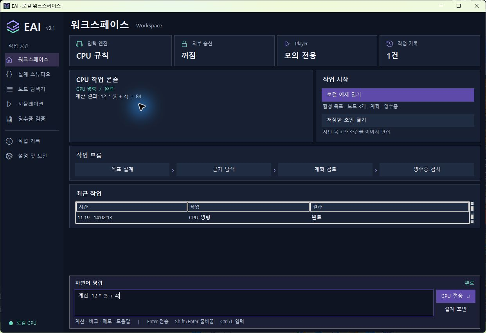

# EAI V3.1 Windows 검토 후보

2026-11-19 KST · `review/astra-eai-v31-final-20261118` · [검토 PR #3](https://github.com/hibi89/EAI/pull/3)

Windows 11에서 한국어 명령을 입력하고 Enter를 눌러 실제 CPU 결과를 확인할 수 있다. 설계 스튜디오의 후보를 Player에 보내 순수 모의실행을 검토하거나, 동일한 목표의 Journey를 다시 계산해 Verifier에서 검사할 수 있다. 최종 EXE에서 계산 결과 84와 재시작 뒤 남은 다섯 건의 기록을 관찰했다.



## 인수물과 기준

| 대상 | 식별자 |
|---|---|
| 원본 브랜치 | `feature/kmong-eai-85-p31-20261112` · `5bd01f2d7132d7e17fc5c216e867a84ce9a3a81b` |
| EXE를 빌드한 제품 소스 | `7b231586907d8ff833a6ff313f4a86d37b601233` |
| 제품 소스와 검증 도구를 포함한 감사 기준 | `3f5efeb810aa0675476f551913d3b6a8d5f7b591`. 이 커밋에는 CLI 출력과 한글 CSV 자료의 수정도 포함된다. EXE에 포함된 EAI 모듈 43개와 진입점·사양·아이콘·Tcl 공지의 Git blob은 감사 기준과 모두 일치한다. [빌드 입력별 SHA](astra-evidence/native-inputs.json) |
| 파일 | `EAI.exe` · 13,024,707 bytes · Windows x64 단일 파일 · Authenticode `NotSigned` |
| EXE SHA-256 | `8e9c7c7d6171d7e59b039f34a784aef1bda67ed3a16018f17a91e1fdcc58e0f3` |
| Ubuntu PR CI, 감사 기준 코드 | 1,110건 중 1,085 PASS, 25 SKIP. 구문 검사, CLI, 별도 ZIP 빌드와 검증 통과. [Actions 실행](https://github.com/hibi89/EAI/actions/runs/44463868900/job/135356840325) |
| 검증 항목 및 수정 파일 | [42 BE + 6 FE, C01–C36, 기존 P0–P38, P2 10개 군](ASTRA_P2_COVERAGE.md) · [커밋별 파일](astra-evidence/changes.txt) |

## 첫 실행

1. 전달받은 `EAI.exe`와 체크섬 파일을 같은 폴더에 둔다. PowerShell에서 `Get-FileHash -Algorithm SHA256 .\EAI.exe`로 위 값과 비교한다.
2. EXE를 열고 홈의 계산 예제를 누른 뒤 Enter를 누른다. CPU 작업 콘솔에 `12 * (3 + 4) = 84`가 나오고 최근 작업에 한 건이 추가된다. Shift+Enter는 줄바꿈, Ctrl+L은 명령창 포커스다.
3. **로컬 예제 열기 → 설계 스튜디오 → 대안 비교**로 두 후보를 확인한다. 후보를 선택한 뒤 **Player에서 검토**를 누르면 단계와 권한이 표시된다. 모의실행에는 별도 확인이 필요하다.
4. **노드 탐색기 → 조회**에서 3개 연습 노드가 보인다. `practice.revision`을 누르면 재계산한 해시와 상위 노드가 열린다. 설계 스튜디오로 돌아와 **영수증 재계산**을 누르면 검증 화면에서 SHA, 충돌, 미확인 건수를 확인할 수 있다.
5. 자신의 목표를 연습하려면 하단의 **설계 초안**을 사용한다. 조건과 예산을 편집하고 **새 사본 저장**을 누른다. 다음 실행에서 **저장한 초안 열기**로 이어간다. 연습용 라이브러리와 임시 계획은 종료 시 정리된다.

사용자가 명시적으로 저장한 초안은 `%LOCALAPPDATA%\EAI\Desktop\drafts`, 허용한 메모는 같은 프로필의 `desktop_history.sqlite3`에 남는다. `workspace.sqlite3`은 최근 100건의 시각·화면·작업 종류·상태와 예산을 보관한다. 새 데스크톱 명령의 원문과 답변은 기록에 저장하지 않는다. 프로그램을 다시 열면 최근 작업의 상태와 해당 작업 공간을 확인할 수 있다. 연습에는 빈 프로필이나 번들 예제를 사용한다.

## Desktop interactions

아래 함수는 `EAIDesktopApp`, `DesktopBridge`와 기존 CPU 모듈의 실제 진입점이다. UI 테스트는 네이티브 Tk 위젯을 사용한다. 파일 선택과 승인 여부를 반복 시험한 경우에는 대화상자 반환만 주입했다. 스크린샷은 Windows에서 실행한 최종 EXE의 관찰 기록이다. [네이티브·브리지 회귀](../tests/test_desktop_workstation.py) · [기존 브리지 회귀](../tests/test_desktop_bridge.py) · [보조 위젯·성능 검사](astra-evidence/native_workload.py)

| 화면과 조작 | 함수와 반환 계약 | 사용자가 보는 결과 및 실행 근거 |
|---|---|---|
| 공통 네비게이션, 홈 작업 흐름, 키보드, 스크롤 | `select → VIEWS`, `focus_command`, `reveal`, `fill_command` | 7개 화면과 상시 명령창. 6개 크기·배율 조합에서 하단 입력과 전송 확인. `seven_pages_composer_resize_and_keyboard` |
| 계산·비교·메모 예제, 전송, 새 초안 | `ask → RuleIntentParser → EAIRunner → CognitiveEngine`. `new_draft → make_problem_draft → ProblemSpec.validate` | 숫자 응답·미지원 HOLD·0으로 나누기 오류·별도 메모 승인. CLI와 데스크톱 답변 일치, 승인한 메모 재열람. EXE에서 직접 계산. |
| 홈의 로컬 예제, 저장한 초안, 최근 행 | `practice → PracticeWorkspace`, `open_problem → load_draft`, `history_table → select` | 실제 두 후보·노드 3개·계획·영수증. 손상 파일과 취소 시 기존 선택 보존. 메타데이터로 재진입. `workspace_journey_failure_and_restart` |
| 초안 편집, 일반/JSON 탭, 적용/닫기, 새 사본 저장 | `edit_problem → ProblemSpec.validate`, `save → save_new_draft → load_draft` | 한국어 목표·필수 조건·가정·위험·예산 편집. 잘못된 JSON은 편집기에서 교정. 저장한 사본만 재열람. 중복 대상은 거부. `native_workload.py`, `journal_retention_settings_concurrency_and_exclusive_draft` |
| 저장소 선택, 대안 비교/중단, 후보 선택 | `choose_library`, `design → preview_architecture → render_architect_explanation`, `request_cancel` | 근거·단계·미확인·충돌이 표시된다. 실제 엔진이 중단을 반환할 때 중단으로 표시. `two_designs_read_only_catalog_and_hash_checked_lineage` |
| 선택한 설계를 Player로, 영수증 재계산 | `review_alternative → stage_json → inspect_plan`, `review_journey → preview_offline_journey → audit_offline_journey_report` | 선택한 실제 PlanSpec과 원 목표 해시로 검토. 같은 목표·저장소의 Journey를 다시 만들어 검사. `selected_design_reaches_player_and_independent_receipt_check` |
| Atlas 저장소, 검색/Enter, 상태 필터, 표·그래프·상위 노드 | `catalog → axnode_catalog`, `inspect_node → node_detail → AXNodeStore.get` | 검색 최대 200개, 그래프 최대 10개, 실제 버전·출처·해시·부모 표시. 활성 WAL 커밋 가시성, 원본 해시 보존, 243개 중 200개 출력 확인. 수동 그래프 클릭도 확인. |
| Player의 ProblemSpec/PlanSpec 선택, 단계·권한 확인, 중단 단계, 모의실행 | `open_problem`, `choose`, `inspect_plan → evaluate_plan_policy`, `player`의 재검사·순수 실행·재생 확인 | 변경된 SHA는 `HOLD_PLAN_CHANGED`, 미허용 연산은 `HOLD_POLICY_DENIED`. 중단 경계와 관찰 단계가 분리되고 외부 행동은 0. `plan_revalidation_cancel_and_approval` |
| Verifier 파일 선택 및 무결성 검사 | `choose → verify → verify_journey → audit_offline_journey_report` | 제공 SHA·재계산 SHA, 충돌·미확인·출처 확인 필요를 표시. 불일치와 유효 해시의 잘못된 계약을 개별 거부. `verifier_distinguishes_digest_failure_and_invalid_contract` |
| History 최신 작업, 행 선택 후 Enter나 더블클릭 | `DesktopState.history → history_table → select` | 최대 100건만 유지. 동일 프로필에서 EXE 종료/재실행 후 5건 보존, 원문 turns 0건, SQLite 무결성 확인. Enter로 원 화면 복귀 확인. |
| Settings 예산, 정책 상태 | `set_limits → WorkspaceLimits → DesktopState.set_limits → apply_limits` | 단계 1–64, 초 1–300, 확장 1–8. 범위 밖 입력 거부와 재시작 보존 확인. CPU 규칙, CLI 전용 Qwen, Hydrogen OFF와 Player 권한 표시. |
| 진행 중 탐색 및 종료 | `run → worker → poll`, `close → request_cancel → destroy` | 한 번에 한 작업. GUI 루프에서 화면 이동, 반환 후 기록, 종료 전 작업 회수. `navigation_during_worker_and_graceful_close` |

[실제 설계 화면](astra-evidence/EAI-Architect.jpg) · [실제 노드 상세](astra-evidence/EAI-Atlas.jpg) · [재시작 뒤 기록](astra-evidence/EAI-Restart.jpg)

## Windows 자체 검증

| 검사 | 결과 |
|---|---|
| 수정 전 동일 호스트 | 1,098건, 12 실패, 45 오류, 18 생략. Windows 잠금·줄바꿈·경로 처리 등의 회귀를 재현했다. |
| 최종 Windows 회귀 | 1,110건, **1,092 PASS · 0 FAIL · 0 ERROR · 18 SKIP**. 생략 사유는 Windows 심볼릭 링크 생성 권한이다. 같은 18건은 Ubuntu에서 모두 통과했다. 두 환경을 합쳐 양쪽 모두 생략된 검사는 0건이다. [교차 확인](astra-evidence/platform-coverage.json) [검사별 결과](astra-evidence/windows-test-cases.txt) |
| 정적 및 필수 검사 | Python 3.11.9 compileall, 소켓 연결을 차단한 모듈 126개 import, CLI version/health, 기본 mypy 1.18.2 127개 모듈 0 오류. 데스크톱 관련 8개는 비주석 함수 본문까지 검사. 기존 필수 검사에서 53파일 구문 통과, 403건 중 398 PASS·5 SKIP. |
| 네이티브·설치 독립성 | 실제 Windows 11 Pro 빌드 26200과 새 오프라인 Windows Sandbox 빌드 26100에서 동일 해시 EXE 두 번씩 실행·종료. 샌드박스는 네트워크·vGPU·클립보드 공유 OFF, PATH에 Python 없음. 게스트 임시 폴더에서 실행. 종료 코드 4회 모두 0. |
| 한국어·화면·키보드 | 1920×1080 호스트, 실제 한글 EXE 명령과 화면 확인. 1920×1080·1366×768 Tk 창과 125% 상당의 Tk 배율, 작은 760×475 창에서 핵심 컨트롤 검사. 시스템 125%로 설정한 별도 물리 모니터 및 실제 IME 자모 조합은 NOT_RUN. |
| Windows CMD P37 | 별도 합성 ZIP의 한국어·공백 경로, 보고서 검증, 반복 실행 시 덮어쓰기 거부 PASS. ZIP 해시는 EXE 해시와 별개다. [P37 JSON](astra-evidence/p37.json) |
| 웹 브라우저 | NOT_APPLICABLE. 제품 화면은 네이티브 Tk다. P32가 내보내는 읽기 전용 HTML 보고서는 검증 대상 파일이다. |

## 성능

측정 장비는 i7-8750H, GTX 1050 Ti, RAM 16GB급 Windows 11 Pro다. EXE 크기는 12.42 MiB다. 창 발견까지의 실시간, 두 프로세스의 working set 합, 누적 CPU 시간, 종료 요청 후 경과를 각각 측정했다. 아래 값은 각 환경에서 차례로 실행한 두 표본이다. [호스트 측정](astra-evidence/host-metrics.json) · [샌드박스 측정](astra-evidence/sandbox-metrics.json)

| 환경 | 첫 창 / 재실행 | 유휴 RAM | 시작 시 누적 CPU | 종료 |
|---|---|---|---|---|
| 실제 노트북 | 4.685 / 2.935초 | 50.7 / 51.0 MiB | 3.422 / 2.594초 | 0.713 / 0.764초 |
| 새 Windows Sandbox | 3.608 / 1.435초 | 49.9 / 49.9 MiB | 1.938 / 1.406초 | 0.571 / 0.629초 |

실제 Tk 소스 경로의 단일 계측에서 계산 547ms, 설계 516ms, 검증 172ms, 모의실행 203ms였다. 243개를 담은 합성 저장소에서 200개를 표시하는 데 329ms, CPU 328ms, 표본의 최대 RSS 51.1MiB였다. 계산 중 이벤트 펌프 관측 간격은 최대 532ms였다. 이 값에는 위젯 재생성과 운영체제 스케줄링이 포함된다. 대량 데이터와 저사양 화면의 지연은 재검토 대상이다. GTX용 프로세스 메모리 카운터가 EAI 인스턴스를 반환하지 않아 VRAM은 `UNMEASURED`다. [작업별 CPU·RAM·이벤트 기록](astra-evidence/workload.json) · [GPU 카운터 결과](astra-evidence/gpu.json)

## 보안·데이터 보존

- 데스크톱의 미지원 입력·검색 거부, 동의 받은 메모만 저장, pure 연산 허용 목록, 승인 후 SHA 재확인, 변조된 영수증과 승격 거부를 합성 입력으로 실행했다. 상호작용 경로에서 지정한 직접 실행·네트워크·자격 증명 호출을 정적으로 검사했다. 이 AST 검사는 직접 이름이 일치하는 호출에 한정된다. [정적·로컬 상태 결과](astra-evidence/static.json)
- SQLite 연결 종료를 명시하고 Windows에서 삭제·재개가 막히던 잠금을 고쳤다. AXNODE 읽기는 크기가 제한된 임시 DB/WAL 사본과 해시 재확인을 사용한다. 합성 파일의 전후 해시, 활성 WAL, 시점 불일치 거부, 임시 복구·epoch·누락/변조 파일 검사를 실행했다. 실제 NTFS junction 경로 거부도 별도 확인했다. 한국어 Windows의 CP949 파이프가 일부 문자를 출력할 때 종료하던 CLI 오류와 UTF-8 선언을 따르지 않던 한글 테스트 자료도 고쳤다. CP949 리다이렉션에서 이모지가 든 열 이름과 계산 결과를 별도 회귀로 확인했다.
- 운영용 원장, 소비된 nonce, breaker, 자격 증명, 고객 DB/백업, 실제 Player 동작과 외부 송신은 승인 보류다. mock·메모리 내 가짜 전송·서명/쿼터 거부를 시험했다. 실서비스 계정의 과금 여부, Google 수신·응답, 실제 정전 복구는 미검증이다.
- 개인 메모와 초안은 로컬에 원문으로 보존된다. 작업 기록의 범위와 별도다. 동시 변경 중인 저장소, 파일 교체 경쟁, 암호 정책, 오래된 사용자 데이터 호환성, 복구와 권한 경계는 독립 감사에서 우선 확인한다. 코드 서명과 상용 배포 심사는 NOT_RUN이다.

## 스택과 패키징

Tk/ttk는 기존 Python CPU 경로에 직접 연결되고 Windows용 CPython에 Tcl/Tk가 포함된다. 다크 테마, 네이티브 파일 선택기, 한글 타이포그래피, 키보드 조작, 클릭 가능한 계보를 구현했고, 이 바이너리의 시작 시간과 메모리를 실측했다. Qt/PySide6는 모델·뷰와 고급 접근성 도구를 갖춘 대안이다. Qt 런타임·플랫폼 플러그인 패키징, 모듈별 LGPL/GPL 또는 상용 라이선스 검토, 위젯 재구현 비용이 추가된다. Qt 버전의 속도와 크기는 UNMEASURED다. 이번 후보에는 Tk를 선택했다. [CPython Tk 문서](https://docs.python.org/3.11/library/tkinter.html) · [Qt for Python 라이선스](https://doc.qt.io/qtforpython-6/licenses.html)

무료 빌드 도구는 PyInstaller 6.17.0이고 기본 제품 의존성 목록은 비어 있다. Tk 8.6.12·Python 3.11.9 DLL, 아이콘과 Python/Tcl/Tk 공지를 아카이브에서 확인했다. 별도 Hydrogen 서명 경로의 선택 의존성은 기본 GUI 실행에 필요하지 않다. 빌드 입력 재현과 전달 EXE 파일 검증은 별개다. 독립 빌드의 바이트 단위 일치까지 측정하지 않았다. [PyInstaller 배포 예외](https://pyinstaller.org/en/stable/license.html) · [EXE 사양 파일](../scripts/eai_desktop.spec)

디자인은 AX Dev Factory 참고 이미지와 UI 표준의 네이비·보라·청록 및 탐색 구성을 사용했다. EAI 자체의 CPU 결과, 작업 기록, 계보, 승인 여부를 중심으로 홈과 하단 입력창을 설계했다. [참고 이미지](https://github.com/hibi89/Freelancer/blob/7e9d78f358c0fe75f7970365e5d30a6da0ab424f/docs/design/AXDEV_DESKTOP_REFERENCE_20261117.webp) · [디자인 표준](https://github.com/hibi89/Freelancer/blob/7e9d78f358c0fe75f7970365e5d30a6da0ab424f/docs/AXDEV_DESKTOP_UI_STANDARD.md)

## 독립 재현

Windows 11, Tk가 포함된 x64 CPython 3.11.9와 Git을 사용한다. 타입 검사는 mypy 1.18.2를 사용했다. 같은 암호 검사를 재현한 호스트에는 선택 의존성 cryptography 50.0.1이 있었다. PyInstaller가 준비된 Python 3.11 환경에서 저장소 루트의 다음 명령을 실행한다.

```powershell
git checkout --detach 3f5efeb810aa0675476f551913d3b6a8d5f7b591
py -3.11 -m compileall -q eai scripts tests
py -3.11 -m unittest discover -s tests -v
py -3.11 scripts/check_eai_v3_p1.py
py -3.11 -m eai --version
py -3.11 -m eai health
py -3.11 -m mypy eai
py -3.11 -m mypy --check-untyped-defs --follow-imports=silent eai/desktop_app.py eai/desktop_bridge.py eai/desktop_example.py eai/desktop_presentation.py eai/desktop_state.py eai/desktop_views.py eai/desktop_widgets.py eai/local_files.py
py -3.11 scripts/accept_windows_candidate.py --ack-windows-host
.\BUILD_EAI_EXE.cmd
Get-FileHash -Algorithm SHA256 .\dist\EAI.exe
.\scripts\measure_desktop_windows.ps1 -Exe .\dist\EAI.exe
```

검토 PR의 증거 폴더에는 추가 측정 스크립트가 있다. 해당 폴더를 포함한 PR HEAD에서 `$env:PYTHONPATH=(Get-Location).Path`로 설정한 뒤 `py -3.11 docs/astra-evidence/native_workload.py`를 실행한다. 이 보조 도구의 RAM 계측에만 psutil이 필요하다. 기본 `static_and_state.py`는 소스와 import를 검사한다. 상태 DB 검사에는 본인이 새로 만든 합성 프로필 경로만 인자로 넘긴다. `Get-FileHash`로 전달받은 EXE를 확인하고 위 **첫 실행** 절차를 로컬에서 반복할 수 있다.

깨끗한 환경 확인에는 새 Windows Sandbox에서 네트워크·vGPU·클립보드를 끄고, 후보 파일만 읽기 전용으로 제공했다. 게스트 임시 폴더에 EXE를 복사해 두 차례 실행한 뒤 정상 창 핸들·종료 코드와 해시를 기록했다. 게스트의 PowerShell 파일 실행 제한을 그대로 유지하고 기본 제공 프로세스 명령으로 관찰했다.

## 남은 판정

| 구분 | 상태와 근거 |
|---|---|
| P1 소스 후보 | BE 42 + FE 6 = 48/48. 가중 공식 구현률 및 P2 검증률 UNASSESSED. |
| Astra 자체 검증 | 이 보고서의 실제 Windows/CI 범위 완료. 순수 시뮬레이션·영수증 무결성과 현실 검증을 구분한다. |
| P36 실제 Qwen | 기본 `qwen2.5:3b` 미설치. 설치된 `qwen3:4b-instruct`에 합성 요청을 보냈으나 두 번 모두 선택을 보류했다. 인증 스크립트 결과 `BLOCKED / LOCAL_MODEL_NOT_VERIFIED`. 예상 ID 선택 및 그에 따른 CPU 영수증 수용 미충족. CPU 기본 동작 확인. [P36 관찰 기록](astra-evidence/qwen.json) |
| 환경·실측 | Windows symlink 생성 18건 SKIP. 별도 물리 1366×768 모니터, 사용자 OS 125% 디스플레이 설정, 실제 IME 조합, 보조기기 사용자 검수 및 하드웨어 전원차단 NOT_RUN. GPU 전용 메모리 표본 UNMEASURED. |
| 운영 권한 | 실제 Hydrogen 호출, 실제 외부 Player, ACTIVE 승격, 기존 사용자 자료 복구, 원본 병합 및 배포 BLOCKED_APPROVAL/HOLD. |
| 독립 감사·High | 독립 기술·보안 감사 NOT_RUN. 이 SHA의 검토를 시작할 수 있다. 웹 High 최종 인수, 공식 가중률 결정, 사용자 실사용 GO 및 출시 승인 대기. |
